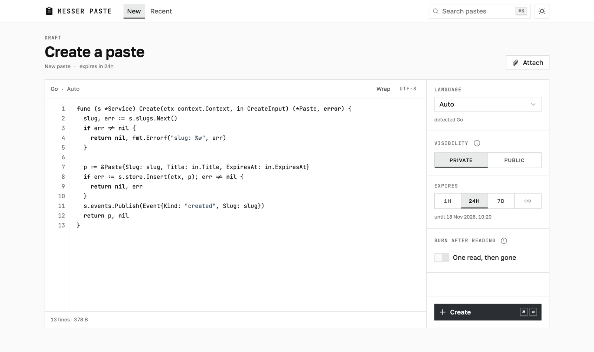

<!-- messer:hero — generated by `python3 ~/Repos/messer-projects/scripts/publish.py --repo . --assets` -->
<picture>
  <source media="(prefers-color-scheme: dark)" srcset="docs/brand/banner-dark.png">
  
</picture>

**A single-user pastebin for text, images and files.**

`MIT` · `Go` · `SQLite` · `v1.1.0` · `ghcr.io/jakobbjelver/messer-paste`
<!-- /messer:hero -->

<picture>
  <source media="(prefers-color-scheme: dark)" srcset="docs/brand/screen-dark.png">
  
</picture>


## Run

```bash
docker run -d --name paste \
  -p 127.0.0.1:8080:8080 \
  -v "$PWD/data:/data" \
  -v "$PWD/pastes:/pastes" \
  ghcr.io/jakobbjelver/messer-paste:latest
```

Or build it yourself: `make docker` (Dockerfile in the repo, SPA embedded). CI publishes
`ghcr.io/jakobbjelver/messer-paste` on every push to `main`, tagged with the commit and with `latest`.

Two volumes: `/data` is the SQLite database, its WAL and the unlock key; `/pastes` is one directory
per paste, holding the original filenames. Nothing else is stateful, and the image runs as a non-root
user. Bind the port to loopback — the binary has no authentication of its own, by design.

Behind a reverse proxy, terminate TLS there and forward to `:8080`. Set `PUBLIC_HOST` to the hostname
that serves read-only links; that host gets a router of its own and answers only `GET /pastes/{slug}`,
`/raw`, `/files/{id}`, `POST /unlock`, `/config` and `/healthz`. Everything else is a 404, including
the archive.

Every value has two doors: an environment variable, and **Settings** in the app (the gear beside the
theme toggle). The environment wins and pins the key — the page shows the variable's name and refuses
the write — but a stored value is kept underneath, so removing the variable restores what you set
there instead of snapping to the default.

## What it does

|  |  |
|---|---|
| **Paste or drop** | text, images or any file — 2 MB of text, 100 MB per file, 250 MB per paste |
| **Expiry** | an hour, a day, a week, or never |
| **Burn after reading** | one reveal, then the bytes are deleted on every device |
| **Public links** | read-only host, optional password, optional view cap |
| **Edit** | replace the text and the file set in place, same URL |
| **Archive** | search titles, filenames and bodies, with the matching fragment |
| **Live** | a new paste appears in every open tab without polling |
| **Phone** | installable; the shell opens offline, the archive never lies |

| Variable | Default | |
|---|---|---|
| `PORT` | `:8080` | listen address — boot only |
| `DATA_DIR` | `/data` | SQLite, its WAL and the unlock key — boot only |
| `PASTE_ROOT` | `/pastes` | one directory per paste — boot only |
| `PASTE_SECRET` | generated | signs the unlock cookie; a `0600` file is created if unset — boot only |
| `PUBLIC_LINKS` | `false` | the public host and the visibility choice, as one switch |
| `PUBLIC_HOST` | empty | the read-only hostname; setting it alone still turns public links on |
| `PUBLIC_PASSWORD_REQUIRED` | `false` | refuse a public paste without a password |
| `MAX_TEXT_BYTES` | `2097152` | text body cap |
| `MAX_FILE_BYTES` | `104857600` | one file |
| `MAX_PASTE_BYTES` | `262144000` | everything a paste holds |
| `MAX_BURN_BYTES` | `10485760` | a burn paste, because the reveal returns it inline |
| `MAX_FILES` | `20` | attachments per paste |
| `DEFAULT_EXPIRY` | `24h` | what the composer starts on |
| `EXPIRY_CHOICES` | `1h,24h,7d,0` | the presets, in order |
| `BURN_ENABLED` | `true` | allow burn pastes at all |
| `READ_ONLY` | `false` | freeze writes (`409 E_READ_ONLY`); settings stay writable |
| `PURGE_AFTER` | `0` | delete pastes older than this, every sweep |
| `UNLOCK_TTL` | `168h` | how long a correct password is remembered |
| `LOG_LEVEL` | `info` | debug, info, warn, error |

`GET /api/v1/settings` lists every key with its value, its default, and which layer set it.

## API

`/api/v1`, JSON, cursor paged. The binary authenticates nobody: the proxy is the door, and the CLI
carries an optional bearer token for whatever sits in front. The contract is `docs/openapi.json`,
served live at `/api/v1/openapi.json`.

| Method | Path | |
|---|---|---|
| `GET` | `/api/v1/pastes` | page or search: `?q=&limit=&cursor=` |
| `POST` | `/api/v1/pastes` | create — multipart, `Idempotency-Key` honoured |
| `GET` | `/api/v1/pastes/{slug}` | detail; `409` for an unrevealed burn paste |
| `PUT` | `/api/v1/pastes/{slug}` | replace; repeated `keep` ids retain files |
| `DELETE` | `/api/v1/pastes/{slug}` | delete one |
| `DELETE` | `/api/v1/pastes` | purge all |
| `GET` | `/api/v1/pastes/{slug}/raw` | the text body |
| `GET` | `/api/v1/pastes/{slug}/files/{id}` | stream a file by public id; `?w=1024` is the resized copy, `?download=1` saves it |
| `POST` | `/api/v1/pastes/{slug}/reveal` | burn: return, delete, `410` after |
| `GET` | `/api/v1/events` | SSE: `created`, `updated`, `deleted`, `purged` |

Titles are derived when you do not supply one: the first line of the text, `report.pdf`, `3 images`,
or `crash loop + 1 image`. Curl recipes for each route: `docs/examples.md`.

`mpaste` is the same binary behind a different name (`/usr/bin/paste` is a macOS utility, so `paste`
cannot be reused):

```bash
mpaste put - -t "build log" --expires 7d     # stdin → URL
mpaste get latest                            # the last paste, text and file list
mpaste ls -q arm64                           # search, with match snippets
```

## Agents

Read [`AGENTS.md`](AGENTS.md) first — it is the code contract. The primer is
[`docs/llms.txt`](docs/llms.txt); the machine contract is `docs/openapi.json`.
`make check` is the gate: fmt, vet, race tests and the frontend type check.

Contributions are closed — fork it. Security reports go to a private advisory, never a public issue.

## Design notes

**Content is not in the database.** Metadata lives in SQLite; every byte of a paste lives in
`<PASTE_ROOT>/<SLUG>/` with the original filename. A paste can be read with `cat`, backed up with
`rsync`, and lost one directory at a time rather than all at once.

**Burn is a tombstone, not a delete.** A reveal returns the payload in the same response that removes
it, and the row keeps a tombstone so a second visitor gets `410` rather than a 404 that suggests they
had the wrong link.

**The public host is a second router, not a second app.** A public paste is readable by anyone with
the link, so it must expire and it cannot burn; a password is an argon2id hash in the row with an
HMAC-signed cookie in the browser, and the view cap counts distinct readers once an hour.

**Realtime is one stream.** `/api/v1/events` carries `created`, `updated`, `deleted` and `purged`;
nothing polls. The stream is the only thing that has to stay open, which is why the app never caches
an API response.

## License

MIT. Not accepting contributions right now — see [`CONTRIBUTING.md`](CONTRIBUTING.md); forking is
welcome. A vulnerability goes to a private advisory, per [`SECURITY.md`](SECURITY.md).
